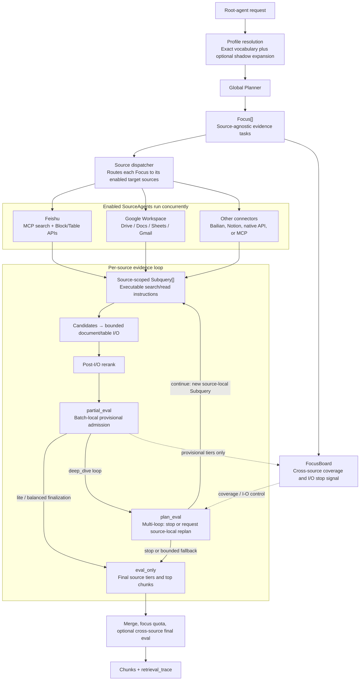

# Multi-Source Retrieval Agent

An evidence-oriented retrieval agent for enterprise knowledge sources. It plans a
query, retrieves from enabled sources, reads the selected documents, and returns
traceable chunks rather than an ungrounded answer.

> **Release status.** Feishu is the currently verified live source. The Google
> Workspace connector is implemented, but its live integration tests and
> production hardening are still pending.

中文说明见每节后的 `中文` 段落。

## What it does / 能力



`Focus` and `Subquery` have different ownership:

- A **Focus** is a global, source-agnostic evidence task produced once for the
  request. It defines *what evidence is needed* and which sources may work on
  it. The same Focus can be routed to Feishu, Google, and another connector;
  subqueries never cross from one Focus into another.
- A **Subquery** is a source-scoped executable instruction. It defines *how a
  particular SourceAgent searches and reads* its connector, such as an MCP
  search expression, a Drive query, or a table filter.
- `FocusBoard` receives only compact provisional coverage signals after
  `partial_eval`. It coordinates future I/O/loop decisions across sources; it
  neither shares document bodies between SourceAgents nor makes the final
  semantic answer decision.

`lite`, `balanced`, and `deep_dive` are preset contracts, not arbitrary
parameter bundles. Sources are explicit: a Feishu-only request cannot silently
dispatch Google, Bailian, or another connector. Returned chunks carry source
metadata and a separate `retrieval_trace` for planner, candidate, read,
rerank, and judgment observations.

中文：`Focus` 是全局的“需要什么证据”的任务，可被多个 source 并发处理；
`Subquery` 是单个 source 的可执行搜索/读取指令。`partial_eval` 先为大候选池生成
临时证据信号，`FocusBoard` 只据此协调跨 source 的后续 I/O 与 loop；最终证据选择仍在
source 的 `eval_only` 和合并阶段完成。Google Workspace 已接入架构，真实环境测试和完善
仍待完成；新的 connector 可按相同 SourceAgent/API/MCP 适配契约接入。

### Connector extension / Connector 扩展

The architecture is deliberately connector-neutral after dispatch. A new
connector implements a SourceAgent adapter that accepts routed `Focus` and
source-scoped `Subquery`, then emits candidates, bounded reads, normalized
chunks, and trace events. Its transport can be a native REST/SDK API, a remote
MCP tool, or a local MCP server. Registering the adapter and its credential
configuration makes it eligible for the same planner, FocusBoard, merge, and
observability contracts; it still needs connector-specific live validation.

## Quick start / 快速开始

Requires Python 3.10+ and the dependencies declared by this repository.

```powershell
python -m venv .venv
.\.venv\Scripts\Activate.ps1
pip install -r requirements-integration.txt
Copy-Item .env.example .env
```

Configure `DEEPSEEK_API_KEY`, the Feishu OAuth application values, and (for
`balanced`/`deep_dive`) Qwen rerank credentials in your local `.env`. The file
is ignored by Git.

Authorize Feishu once. The command opens a browser, validates OAuth state, and
atomically writes the short-lived access token plus rotating refresh token to
your local `.env`:

```powershell
python -m feishu_read_tool.oauth_tokens authorize-browser --redirect-uri "http://127.0.0.1:8765/callback" --scopes "offline_access search:docs:read"
python -m feishu_read_tool.oauth_tokens status
```

The runtime refreshes a project-env access token five minutes before expiry. An
explicit `AgentConfig.feishu_uat` is caller-owned and is not refreshed. Use
`python -m feishu_read_tool.oauth_tokens status` to inspect expiry and scope
flags without printing credentials. Authorize the document/table scopes needed
by your enabled features in addition to the minimal search scopes shown above.

中文：复制 `.env.example` 后只在本地填写密钥；OAuth 命令会写入被忽略的 `.env`，
运行时会在即将过期时自动刷新 UAT。

## Embed from another root agent / 供外部 Root Agent 接入

The small public contract is deliberately split into a construction object and
a request object. An upstream root agent usually needs only these two inputs:

| Object | Required fields | Use it for |
| --- | --- | --- |
| `AgentConfig` | `preset`, `sources`, and either local env loading or credentials | Stable runtime policy and source access. |
| `RetrieveRequest` | `user_query` | One retrieval turn; optionally override only its preset, source list, or credentials. |

For a local deployment managed by the repository, use `load_from_env=True`.
It reads the project `.env`, checks the Feishu OAuth token, and refreshes it
when needed. This is the quickest integration path:

```python
import asyncio
from retrieve_agent_client import config, request, invoke_retrieve_agent

async def retrieve_for_parent(user_query: str):
    return await invoke_retrieve_agent(
        config(preset="balanced", sources=["feishu"], load_from_env=True),
        request(user_query=user_query),
    )

result = asyncio.run(retrieve_for_parent("What were this week's sales and net revenue?"))
for chunk in result.chunks:
    print(chunk["source_tool"], chunk["chunk_id"], chunk["heading_path"])
```

中文：外部 Root Agent 的最小接入只需要传 `AgentConfig`（运行策略和凭证来源）和
`RetrieveRequest(user_query=...)`（单次请求）。本地项目部署使用
`load_from_env=True`，即可复用本项目 OAuth 的自动刷新链路。

### Credential ownership and one-call overrides / 凭证归属与单次覆盖

If the parent owns the credential, inject it explicitly and keep environment
loading off. Explicit `feishu_uat` is intentionally **not** auto-refreshed:
the parent must rotate it before the call. This avoids silently writing a
parent-owned token into the repository's `.env`.

```python
from retrieve_agent_client import config, request, invoke_retrieve_agent

parent_config = config(
    preset="balanced",
    sources=["feishu"],
    feishu_uat=parent_owned_uat,
    load_from_env=False,
)
result = await invoke_retrieve_agent(
    parent_config,
    request(
        user_query=user_query,
        preset_override="lite",                 # optional for this turn
        enabled_sources_override=["feishu"],    # optional safety fence
    ),
)
```

The call returns `RetrieveInvocationResult`:

| Field | Contract for the parent |
| --- | --- |
| `chunks` | Retrieval chunks. Check `source_tool`, `chunk_id`, `heading_path`, `source_url`, `score`, and `confidence_tier` before answer synthesis. |
| `metadata` | Retrieval payload excluding `chunks`, including the structured trace when emitted. |
| `progress_events` | User-visible progress text emitted during the run. |
| `raw_payload` | Original structured retrieval payload for an audited integration. |

`invoke_retrieve_agent()` builds a fresh ADK agent and in-memory runner for
one call, then closes it. It is the safest simple boundary for a parent that
does not share a runner. A parent already hosted on Google ADK can instead
mount a long-lived child using `build_retrieve_agent_with_config()` and own the
runner/session lifecycle itself. For advanced policy (source timeouts, loop
limits, profile controls, rerank/table walls), construct `RetrieveConfig` plus
`SourceConfig` and call `retrieve_agent.build_retrieve_agent()` directly.

中文：显式传入 `feishu_uat` 时，token 属于上游，程序不会刷新或写入 `.env`；上游
必须自行轮换。`invoke_retrieve_agent()` 是“一次调用、一套 runner”的简单边界；如
外部 Root Agent 已托管 ADK，可用 `build_retrieve_agent_with_config()` 挂载长期 child
agent 并自行管理 session。

## Configuration / 配置说明

| Entry point | Purpose |
| --- | --- |
| `AgentConfig` | Public preset, sources, credentials, planner/eval model and thinking injection. |
| `RetrieveRequest` | Per-call query, preset/source override, and explicit auth override. |
| `RetrieveConfig` | Internal/advanced behavior, profile settings, global planner, and per-source overrides. |
| `SourceAgentConfig` | Source timeout, loops, post-I/O rerank, table read walls, and source output budget. |
| `GlobalPlannerConfig` | Planner model, timeout, Focus limit, v1 fallback, and A/B `force_v1`. |
| `.env` | Local credentials and root-agent runtime defaults. |

At the public boundary, do not pass planner prompts, raw chunks, or private
document identifiers as configuration. The parent passes the user query; this
agent produces traceable chunks. Advanced tuning belongs to the explicit
internal configuration objects above, so a preset cannot be accidentally
changed by a prompt field.

Default planner and eval model: `deepseek/deepseek-v4-flash`. Thinking is
explicitly disabled by default for both structured planner and eval calls.

`FEISHU_MCP_SEARCH_MAX_CONCURRENCY=6` caps shared in-flight MCP search calls.
Fallback searches wait for an occupied slot rather than bypassing the cap; it is
not a sustained-QPS guarantee.

### Presets

| Preset | Source loop | Rerank/eval behavior | Intended use |
| --- | --- | --- | --- |
| `lite` | One loop | No final eval layer; Feishu uses the narrow MCP/block path | Low-latency exploration |
| `balanced` | Feishu up to 3, Bailian up to 2, Google 1 | Feishu and Google post-I/O rerank; rule final selection | Default trade-off |
| `deep_dive` | Feishu up to 2, Bailian up to 3, Google 1 | Source plan-eval loop where enabled; LLM-tool final eval only when more than one source is active | Ambiguous or broad retrieval |

All presets still retain source-level planning and evidence admission. “No final
eval layer” does not mean “no planner/eval-model call anywhere in the source
chain”; it means the top-level final selector is not the LLM eval layer.

### Profile behavior / Profile 逻辑

Each root request resolves an exact Profile pack once and attaches it to the
plan and source evaluation prompts. Exact entity/expression matching remains
available even when semantic expansion is disabled.

- `RetrieveConfig.profile_rerank.enabled=False` disables semantic registry
  reranking; it does not disable exact Profile resolution.
- `profile_rerank.shadow=True` (default) records semantic candidates but does
  not inject one into the planner. Set it to `False` only after the score and
  margin gate are intentionally accepted.
- `profile_governance` is a non-blocking, redacted trace/outbox boundary. It
  does not read document bodies and does not autonomously change a Profile
  without an explicit validated holdout decision.

中文：Profile 的精确词表每次都会产生；`enabled` 控制的是语义扩展，`shadow`
控制语义候选是否参与 planner，不是总开关。

## Release E2E check / 发布前 E2E

For the Web ADK acceptance run:

```powershell
adk web adk_agents --host 127.0.0.1 --port 8788
python scripts/verify_feishu_release_e2e.py --preset balanced --source-timeout-s 120
```

The Web workflow gives retrieval a 200-second deadline and answering a separate 120-second deadline.
Use the chat for progress and State for the complete evidence handoff. If Feishu
authorization is required, follow the link in the Web session and resend the
query after the callback. The server picks up the new credential on that turn.

Local tests and internal documentation are intentionally excluded from the
published repository.

Run the body-free Feishu-only smoke check after configuring local credentials:

```powershell
python scripts/verify_feishu_release_e2e.py
# Optional: run one preset against the same redacted release smoke query.
python scripts/verify_feishu_release_e2e.py --preset lite
# Optional diagnostic override; omit it to retain the preset's own source wall.
python scripts/verify_feishu_release_e2e.py --preset deep_dive --source-timeout-s 45
```

It checks OAuth status, forces the selected preset + `feishu` + Flash models
with thinking disabled, and writes only a redacted JSON summary under
`tests/artifacts/release_e2e/`. Success means non-empty Feishu chunks and a
trace containing planner/source activity. It reports MCP/Block route counts,
latency, and error categories, but never stores token values, query text,
document URLs, or chunk bodies.

Treat an MCP `Unauthorized` response or a non-JSON MCP inner response as a
release blocker, not as an empty search result.

## Security and data policy / 安全与数据边界

- Never commit `.env`, access tokens, refresh tokens, API keys, SQLite profile
  stores, raw retrieval artifacts, or real Feishu document URLs/content.
- Public tests use synthetic or mocked data. Live Feishu tests are local only.
- Before a public push, run the repository's unit tests and a secret scan over
  both the worktree and reachable Git history.

This project is distributed under the [MIT License](LICENSE).
