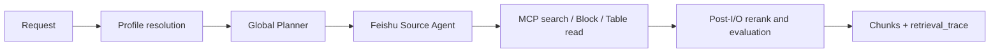

# Multi-Source Retrieval Agent

An evidence-oriented retrieval agent for enterprise knowledge sources. It plans a
query, retrieves from enabled sources, reads the selected documents, and returns
traceable chunks rather than an ungrounded answer.

> **Release status.** The public release verifies that the Feishu-only execution
> path is runnable. It does **not** claim a stable P3/Gold benchmark pass: live
> Feishu document reads and provider calls still have workload-dependent tails.

中文说明见每节后的 `中文` 段落。

## What it does / 能力



- `lite`, `balanced`, and `deep_dive` are preset contracts, not arbitrary
  parameter bundles.
- Sources are explicit. A Feishu-only request cannot silently dispatch Google
  or Bailian retrieval.
- Returned chunks carry source metadata and a separate `retrieval_trace` for
  planning, candidate, read, and judgment observations.

中文：系统先生成有界 Focus/Subquery，再按启用 source 检索、读取并在 I/O 后做
重排/评估；结果是可追踪的 chunks，而非直接生成答案。

## Quick start / 快速开始

Requires Python 3.10+ and the dependencies declared by this repository.

```powershell
python -m venv .venv
.\.venv\Scripts\Activate.ps1
pip install -r requirements-integration.txt
Copy-Item .env.example .env
```

Configure `DEEPSEEK_API_KEY`, the Feishu OAuth application values, and (for
`balanced`/`deep_dive`) Qwen rerank credentials in your local `.env`. The file
is ignored by Git.

Authorize Feishu once. The command opens a browser, validates OAuth state, and
atomically writes the short-lived access token plus rotating refresh token to
your local `.env`:

```powershell
python -m feishu_read_tool.oauth_tokens authorize-browser --redirect-uri "http://127.0.0.1:8765/callback" --scopes "offline_access search:docs:read"
python -m feishu_read_tool.oauth_tokens status
```

The runtime refreshes a project-env access token five minutes before expiry. An
explicit `AgentConfig.feishu_uat` is caller-owned and is not refreshed. See
[the OAuth lifecycle guide](docs/feishu_oauth_token_lifecycle.md) for required
scopes and failure handling.

中文：复制 `.env.example` 后只在本地填写密钥；OAuth 命令会写入被忽略的 `.env`，
运行时会在即将过期时自动刷新 UAT。

## Feishu-only usage / 仅飞书调用

```python
import asyncio
from retrieve_agent_client import config, request, invoke_retrieve_agent

async def main():
    result = await invoke_retrieve_agent(
        config(preset="balanced", sources=["feishu"], load_from_env=True),
        request(user_query="What were this week's sales and net revenue?"),
    )
    for chunk in result.chunks:
        print(chunk["source_tool"], chunk["chunk_id"], chunk["heading_path"])

asyncio.run(main())
```

`AgentConfig` is the public construction entry point. `RetrieveRequest` can
override only the preset, enabled sources, or caller-owned credentials for one
request. Use `RetrieveConfig` and `SourceAgentConfig` when embedding the agent
and deliberately changing advanced runtime behavior.

## Configuration / 配置说明

| Entry point | Purpose |
| --- | --- |
| `AgentConfig` | Public preset, sources, credentials, planner/eval model and thinking injection. |
| `RetrieveRequest` | Per-call query, preset/source override, and explicit auth override. |
| `RetrieveConfig` | Internal/advanced behavior, profile settings, global planner, and per-source overrides. |
| `SourceAgentConfig` | Source timeout, loops, post-I/O rerank, table read walls, and source output budget. |
| `GlobalPlannerConfig` | Planner model, timeout, Focus limit, v1 fallback, and A/B `force_v1`. |
| `.env` | Local credentials and root-agent runtime defaults. |

Default planner and eval model: `deepseek/deepseek-v4-flash`. Thinking is
explicitly disabled by default for both structured planner and eval calls.

`FEISHU_MCP_SEARCH_MAX_CONCURRENCY=6` caps shared in-flight MCP search calls.
Fallback searches wait for an occupied slot rather than bypassing the cap; it is
not a sustained-QPS guarantee.

### Presets

| Preset | Source loop | Rerank/eval behavior | Intended use |
| --- | --- | --- | --- |
| `lite` | One loop | No eval layer; narrow fast path | Low-latency exploration |
| `balanced` | One loop | Feishu post-I/O rerank; rule evaluation | Default production trade-off |
| `deep_dive` | Up to two loops | Feishu rerank and LLM-tool eval layer | Ambiguous or broad retrieval |

### Profile behavior / Profile 逻辑

Each root request resolves an exact Profile pack once and attaches it to the
plan and source evaluation prompts. Exact entity/expression matching remains
available even when semantic expansion is disabled.

- `RetrieveConfig.profile_rerank.enabled=False` disables semantic registry
  reranking; it does not disable exact Profile resolution.
- `profile_rerank.shadow=True` (default) records semantic candidates but does
  not inject one into the planner. Set it to `False` only after the score and
  margin gate are intentionally accepted.
- `profile_governance` is a non-blocking, redacted trace/outbox boundary. It
  does not read document bodies and does not autonomously change a Profile
  without an explicit validated holdout decision.

中文：Profile 的精确词表每次都会产生；`enabled` 控制的是语义扩展，`shadow`
控制语义候选是否参与 planner，不是总开关。

## Release E2E check / 发布前 E2E

Run the body-free Feishu-only smoke check after configuring local credentials:

```powershell
python scripts/verify_feishu_release_e2e.py
```

It checks OAuth status, forces `balanced` + `feishu` + Flash models with
thinking disabled, and writes only a redacted JSON summary under
`tests/artifacts/release_e2e/`. Success means non-empty Feishu chunks and a
trace containing planner/source activity. It reports MCP/Block route counts,
latency, and error categories, but never stores token values, query text,
document URLs, or chunk bodies.

Treat an MCP `Unauthorized` response or a non-JSON MCP inner response as a
release blocker, not as an empty search result.

## Security and data policy / 安全与数据边界

- Never commit `.env`, access tokens, refresh tokens, API keys, SQLite profile
  stores, raw retrieval artifacts, or real Feishu document URLs/content.
- Public tests use synthetic or mocked data. Live Feishu tests are local only.
- Before a public push, run the repository's unit tests and a secret scan over
  both the worktree and reachable Git history.

This project is distributed under the [MIT License](LICENSE).
